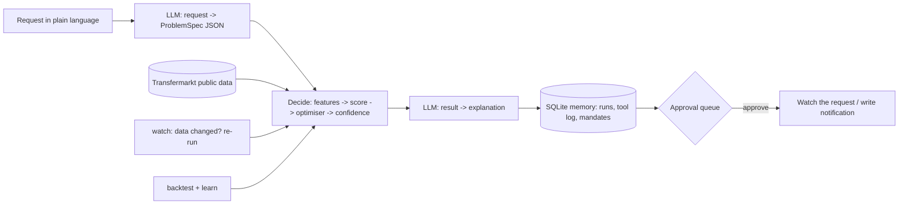

# Football Decision Agent (Challenge 4: Algorithm/Solution Agent Creator)

Describe a recruitment need in plain language ("a left back under 3M€ who fits LaLiga"). The agent turns it into a precise
problem, scores every candidate, picks the best affordable option with an integer-programming solver, tells you how
stable that pick is, and tests the whole method on past transfer windows.
The language model only translates the request and writes the explanation. **The decision never comes from the LLM.**


## How it works



| Brief requirement | Where |
|---|---|
| Orchestrator, tools, memory | `agent.py`, `data.py`/`features.py`/`optimize.py`, `store.py` (SQLite) |
| Real proactivity | `agent.watch_once` / `watch`: checks whether the data changed, re-runs approved requests, proposes a notification if the pick moved |
| Human in the loop | `store.py` queue: nothing runs until `approve` |
| Observability | every tool call (time, success) and every run (tokens, cost) is logged: `python -m dagent log` |
| Evaluation | `backtest.py` (baselines, year-level intervals), `learn.py` (walk-forward), `tests/` |
| Real public data, cited | Transfermarkt public dataset; every pick carries its source |

## Run it (under 10 minutes)

```bash
pip install -r requirements.txt
cp .env.example .env                       # put GEMINI_API_KEY=... in it (no comment on the same line)
python -m dagent llmcheck                  # optional: checks the key and finds a model it can call
python -m dagent fetch                     # downloads the data once (a few hundred MB)
python -m dagent learn --test-years 2019-2023    # learns the weights on past years, tests on later years, saves them
python -m dagent ask "we need a left back under 3M€ who fits LaLiga"
python -m dagent queue                     # see proposed actions
python -m dagent approve 1                 # approve (or `reject 1`; `approve 2 --edit-body "new text"` edits a notification first)
python -m dagent watch --once --force      # proactive re-run (long-running mode: `watch --hours 6`)
python -m dagent backtest                  # comparison with simple baselines
python -m dagent log                       # runs, tokens, cost, tool calls
python -m pytest -q
```

## The decision, step by step

1. **Spec** (`spec.py`): position, number of signings, budget, age window, target league, minimum minutes, club cap.
2. **Features** (`features.py`): last 365 days of minutes, goals, assists, cards, plus the latest market value, all taken only from
   rows dated on or before the decision date (a test tampers with the future and checks nothing changes).
3. **Score** (`scoring.py`): three ingredients (production, availability, discipline), measured against all regulars in that position.
   Small samples are pulled toward the average, and production is discounted for weaker leagues.
4. **Optimiser** (`optimize.py`): maximise total score with exactly n players, total market value within budget, club cap.
   Checked against brute force in the tests.
5. **Confidence** (`optimize.py`): re-run the decision 200 times with perturbed weights and noisy scores; confidence is how often each
   pick stays in the top-K of the ranking (high >= 80%, medium >= 50%).
6. **Weights** (`learn.py`): fitted by non-negative ridge regression on what happened in the following year. Walk-forward:
   a test year only uses windows whose outcome year had already finished (tested).
7. **Backtest** (`backtest.py`): every 1 July, rebuild the world with earlier data only, pick players, measure the next 365 days
   (minutes, share playing >= 1500 minutes, market-value growth) against random, "highest value" and "most minutes" baselines.
   Intervals resample whole years, because cases within a year are not independent.

## Assumptions and what breaks them

- Price = market value (no fee or wage data is public). If real fees differ a lot, the budget constraint is off.
- League adjustment is a proxy (log mean market value of a league's regulars), not a fitted coefficient.
- The learned weights optimise a proxy (next-year minutes, blended with value growth), so they lean on availability.
- A player missing from next year's data counts as 0 minutes; the dataset does not cover every league.
- Only five yearly test windows: treat the intervals as suggestive.
- No event data (passes, tackles, ...), so playing style cannot be scored and stylistic requests are reported as not applied.
  An earlier version tried StatsBomb Open Data for this; its open sample does not cover current players, so it never contributed
  and was removed to keep the system simpler and honest.

## Repo map

`agent.py` ask/watch loop, `llm.py` the two LLM jobs, `spec.py` the problem, `data.py` download/load, `features.py`, `scoring.py`,
`optimize.py` solver + confidence, `decide.py` the procedure, `backtest.py`, `learn.py`, `store.py` memory + approval queue, `cli.py`.
Data: Transfermarkt public dataset, https://github.com/dcaribou/transfermarkt-datasets (check its terms before commercial use).
